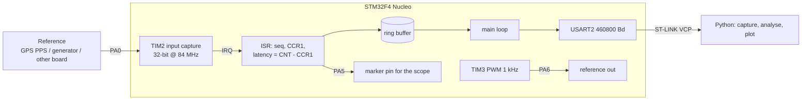

# stm32-timing-lab

[](https://github.com/srinath-kothakapu/stm32-timing-lab/actions/workflows/ci.yml)

I wanted to find out how good the clocks on STM32 Nucleo boards actually are: how much jitter
there is on a timestamp, how far two boards drift apart, and how quickly the MCU reacts to an
external edge. This project measures that.

A reference signal goes into PA0. TIM2 timestamps every rising edge in hardware (input
capture, 32 bit, 84 MHz), and the board streams the timestamps over the ST-LINK virtual COM
port. A small Python tool records the stream and calculates period jitter, frequency offset in
ppm, accumulated drift and the Allan deviation. With two boards connected to the same
reference I can compare them directly, and an oscilloscope is used to check the interrupt
latency that the firmware measures.



## Some decisions and why

The timestamp is latched by the timer hardware on the edge, so interrupt latency does not end
up in the measurement. I still measure the latency (`TIM2->CNT - CCR1` as the first thing in
the ISR) because it is interesting on its own, and PA5 goes high while the ISR runs so I can
compare it with the scope.

The F411 runs at 84 MHz and the F446 at 168 MHz, but I set the bus dividers so that TIM2 gets
84 MHz on both. One tick is 11.905 ns on either board, so the numbers can be compared directly.

The firmware is written on registers with CMSIS only, no HAL. It is about 4 KB, and every
peripheral setting is visible in `firmware/src`.

On the PC side every edge gets a cycle number based on the time since the previous edge,
not on the sequence number. If a line gets lost on the UART, or there is a glitch edge from
ringing on the wire, it shows up as a gap or gets thrown out instead of messing up the ppm fit.

When two boards capture the same reference at the same time, the error of the reference
cancels out of the difference between them. So the board-to-board offset is valid even if
the reference itself is not perfect.

One thing I found while testing the analysis: if a board measures its own PA6 output, every
period is exactly 84000 ticks and the jitter is zero. The reference and the counter come from
the same clock. The quantisation noise (about tick/√6 ≈ 4.9 ns) only appears with a reference
that is not synchronous to the timer.

## Folders

```
firmware/        STM32 firmware (CMake + arm-none-eabi-gcc)
  src/           clock setup, TIM2 capture and ISR, TIM3 reference output, UART
  src/common/    hardware independent parts: ring buffer, line protocol, calculations
  test/          unit tests for src/common, built for the PC
  sim/           Renode test: boots the real firmware on an emulated STM32F4
host/            Python package stm32timing (capture, analyze, compare)
  tests/         pytest, checks the analysis on generated data with known values
  examples/      script that generates the simulated example report
docs/            wiring, measurement procedure, example report
data/            raw logs (.log.gz)
reports/         generated results and plots
```

## Building

You need CMake 3.20+, Ninja and the Arm GNU toolchain. The CMSIS headers and ST startup files
are downloaded when CMake configures the project.

```
cd firmware
cmake --preset f411-hse        # also f411-hsi, f446-hse, f446-hsi
cmake --build --preset f411-hse
```

To flash, copy `build/f411-hse/timing_f411re_hse.bin` to the NUCLEO drive, or use
STM32CubeProgrammer:

```
STM32_Programmer_CLI -c port=SWD -w build/f411-hse/timing_f411re_hse.elf -rst
```

`-DREF_HZ=1000` sets the frequency on PA6 and `-DCAPTURE_FILTER=0` the input filter. At
460800 baud the stream keeps up with about 1.5 kHz.

## Recording and analysing

```
pip install -e host
python -m stm32timing capture --port COM5:A --seconds 600 --name e1_loopback --note "PA6->PA0"
python -m stm32timing analyze data/e1_loopback_A.log
python -m stm32timing compare data/e3_ref_hse_A.log data/e3_ref_hse_B.log --ref-hz 1000
```

What the board sends:

```
H,1,uid=1A2B3C4D,target=F411RE,clk=HSE,ftim=84000000,ref=1000
C,4711,3954816020,25,0      seq, capture ticks, ISR latency in ticks, flags
S,seq=4712,drop=0,ovc=0
```

The experiments and the wiring for each one are in [docs/MEASUREMENT_PLAN.md](docs/MEASUREMENT_PLAN.md)
and [docs/HARDWARE.md](docs/HARDWARE.md).

To see what the output looks like before connecting any hardware, there is an example report in
[docs/example](docs/example/README.md). It is made from **simulated data** (`host/examples/make_demo.py`),
so the numbers in it are not measurements.

## Tests

```
pytest host/tests
cmake -S firmware/test -B build/fwtest && cmake --build build/fwtest && ctest --test-dir build/fwtest
```

The firmware also runs in the [Renode](https://renode.io) emulator. `firmware/sim/firmware.robot` boots
each of the four builds on an emulated STM32F4, waits for the header and status lines on USART2 and
then reads back the TIM2, TIM3, GPIOA, USART2, NVIC and PLL registers to check they are set up as
intended. This caught one bug: the F411 has reserved bits in `RCC_PLLCFGR` that must keep their
reset value, and the first version wrote them as zero. Renode does not model input capture from a
pin, and its timers run at a fixed rate, so the actual timing numbers still need real boards.

```
renode-test firmware/sim/firmware.robot      # after building the four presets
```

GitHub Actions runs all of this and builds the four firmware variants on every push.
