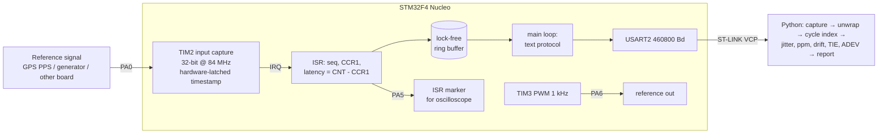

# STM32 timing lab — jitter, drift and board-to-board synchronisation

[](https://github.com/srinath-kothakapu/stm32-timing-lab/actions/workflows/ci.yml)

Measures how accurately STM32 boards keep time: hardware timestamps of a reference signal via
timer input capture, interrupt-latency measurement, and host-side analysis of period jitter,
frequency offset (ppm), accumulated drift and Allan deviation. Two boards can be compared
against a common reference, and results are cross-checked with an oscilloscope.

**Status:** firmware, analysis tools and tests are complete. **Measurements are pending** —
see [docs/MEASUREMENT_PLAN.md](docs/MEASUREMENT_PLAN.md); results will go into
[docs/REPORT.md](docs/REPORT.md).

## How it works



Design decisions:

- **Timestamps come from hardware, not software.** TIM2 latches the counter on the edge, so
  interrupt latency and its jitter do not enter the measurement. Latency is still measured
  (`CNT − CCR1` at ISR entry) and shown separately.
- **Same 84 MHz timer clock on F411 and F446** (different PLL/bus dividers), so 1 tick = 11.905 ns
  on both boards and results compare directly.
- **Register-level firmware** (CMSIS only, no HAL): about 4 KB of flash, and every peripheral setting is visible in the code.
- **Cycle indexing on the host** assigns each edge its reference-cycle number from elapsed time,
  so dropped serial lines and glitch edges are detected and excluded instead of corrupting the
  frequency estimate.
- **Reference error cancels** when two boards capture the same reference at the same time:
  the board-to-board offset is valid even with an imperfect reference.

## Repository layout

```
firmware/            STM32 firmware (CMake, arm-none-eabi-gcc)
  src/               clock tree, TIM2 capture + ISR, TIM3 reference out, UART
  src/common/        portable code: ring buffer, line protocol, calculations
  test/              host unit tests for src/common (ASan/UBSan)
host/                Python package `stm32timing`: capture, analyze, compare
  tests/             pytest: analysis verified against synthetic data with known answers
docs/                hardware/wiring, measurement plan, report
data/                raw capture logs (*.log.gz)
reports/             generated results (Markdown, JSON, plots)
```

## Build and flash

Requires CMake ≥ 3.20, Ninja and the Arm GNU toolchain (`arm-none-eabi-gcc`). The CMSIS headers
and ST startup files are downloaded at configure time (pinned versions).

```
cd firmware
cmake --preset f411-hse        # or f411-hsi, f446-hse, f446-hsi
cmake --build --preset f411-hse
```

Flash by copying `build/f411-hse/timing_f411re_hse.bin` onto the NUCLEO USB drive, or with
STM32CubeProgrammer: `STM32_Programmer_CLI -c port=SWD -w build/f411-hse/timing_f411re_hse.elf -rst`.

Build options: `-DREF_HZ=1000` (reference output frequency), `-DCAPTURE_FILTER=0` (input filter).
Streaming at 460800 Bd supports reference frequencies up to about 1.5 kHz.

## Capture and analyse

```
pip install -e host
python -m stm32timing capture --port COM5:A --seconds 600 --name e1_loopback --note "PA6->PA0"
python -m stm32timing analyze data/e1_loopback_A.log
python -m stm32timing compare data/e3_ref_hse_A.log data/e3_ref_hse_B.log --ref-hz 1000
```

Example output line format from the board:

```
H,1,uid=1A2B3C4D,target=F411RE,clk=HSE,ftim=84000000,ref=1000
C,4711,3954816020,25,0      seq, capture ticks, ISR latency ticks, flags
S,seq=4712,drop=0,ovc=0
```

## Tests

```
pytest host/tests                                              # analysis (24 tests)
cmake -S firmware/test -B build/fwtest && cmake --build build/fwtest && ctest --test-dir build/fwtest
```

CI runs both test suites and cross-compiles all four firmware configurations.

## Results

_Pending — see [docs/REPORT.md](docs/REPORT.md)._

## Third-party files

The CMSIS headers and startup files downloaded at build time are Apache-2.0 (ARM, STMicroelectronics).
