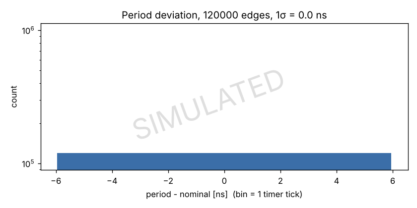
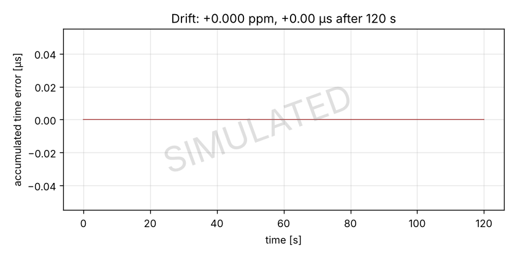
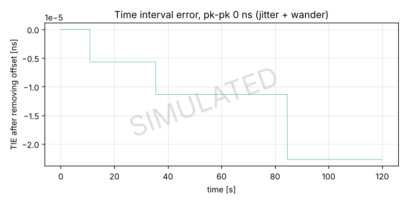
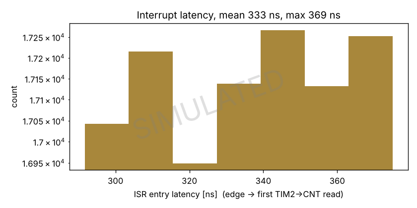

> **Simulated data, not a measurement.** See [the example README](../README.md).

## E1 loopback (simulated)

Source log: `simulated (e1_loopback, generated by host/examples/make_demo.py)`  
Board: F411RE, UID `DE300001`, clock **HSE**, timer 84 MHz (1 tick = 11.905 ns)  
Reference: 1000 Hz nominal, 120000 edges over 120.0 s

| Quantity | Value |
|---|---|
| Period jitter, 1σ | 0.00 ns |
| Period jitter, peak-to-peak | 0.0 ns (0 ticks) |
| Cycle-to-cycle jitter, 1σ | 0.00 ns |
| Timer quantisation floor (tick/√6) | 4.86 ns |
| Frequency offset vs reference | +0.000 ppm (±2.4e-12, 95 %) |
| Accumulated drift at end of run | +0.00 µs after 120.0 s |
| TIE (offset removed), peak-to-peak | 0.0 ns |
| Allan deviation at τ = 1 s | 0.00e+00 |
| ISR latency mean / p99.9 / max | 333 / 369 / 369 ns |
| ISR latency in ticks (min..max) | 25 .. 31 |
| Missing cycles / glitch edges / over-captures | 0 / 0 / 0 |

_Every period is exactly 84000 ticks: the reference is synchronous with the capture timer (expected when a board measures its own output)._

