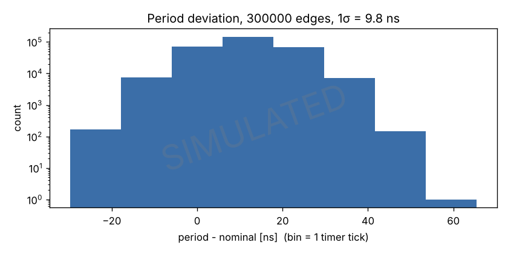
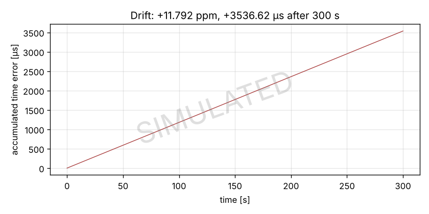
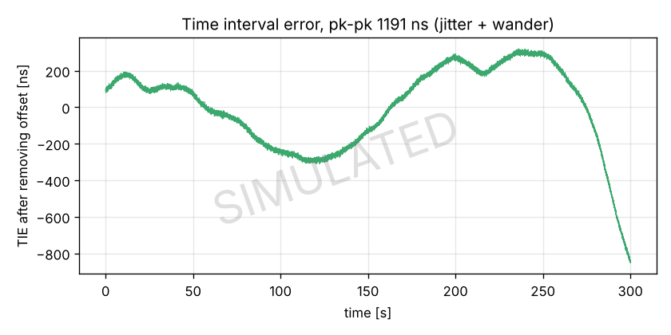
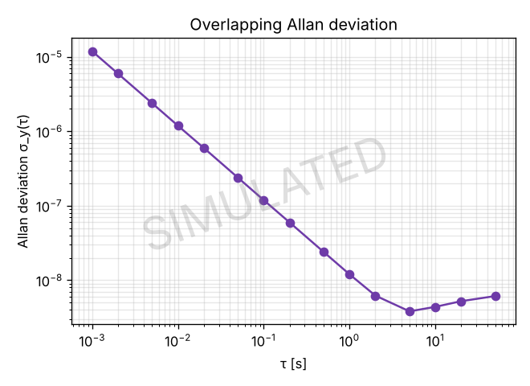
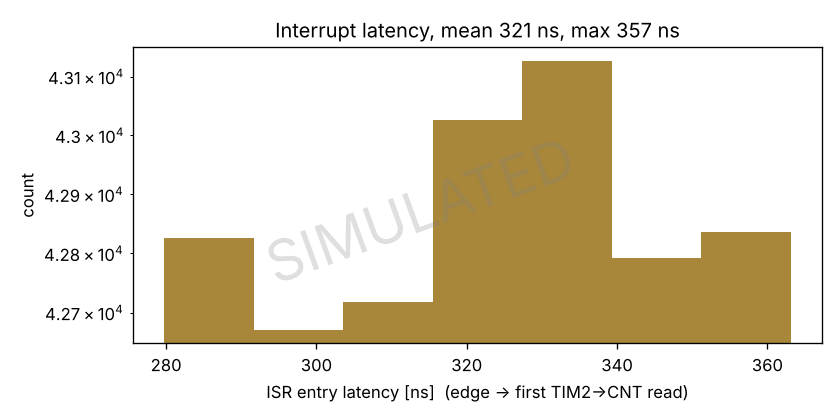

> **Simulated data, not a measurement.** See [the example README](../README.md).

## E3 board A vs reference (simulated)

Source log: `simulated (e3_board_a, generated by host/examples/make_demo.py)`  
Board: F411RE, UID `DE300001`, clock **HSE**, timer 84 MHz (1 tick = 11.905 ns)  
Reference: 1000 Hz nominal, 300000 edges over 300.0 s

| Quantity | Value |
|---|---|
| Period jitter, 1σ | 9.77 ns |
| Period jitter, peak-to-peak | 83.3 ns (7 ticks) |
| Cycle-to-cycle jitter, 1σ | 16.92 ns |
| Timer quantisation floor (tick/√6) | 4.86 ns |
| Frequency offset vs reference | +11.792 ppm (±9.6e-06, 95 %) |
| Accumulated drift at end of run | +3536.62 µs after 300.0 s |
| TIE (offset removed), peak-to-peak | 1190.7 ns |
| Allan deviation at τ = 1 s | 1.20e-08 |
| ISR latency mean / p99.9 / max | 321 / 357 / 357 ns |
| ISR latency in ticks (min..max) | 24 .. 30 |
| Missing cycles / glitch edges / over-captures | 0 / 0 / 0 |

