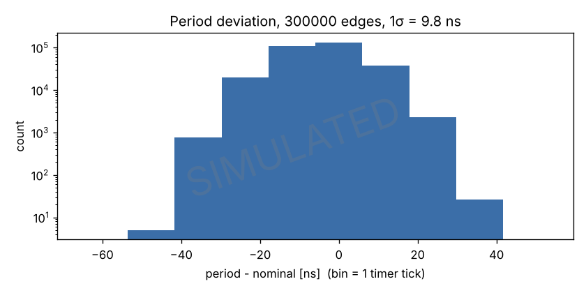
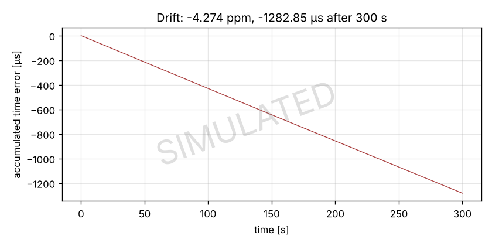
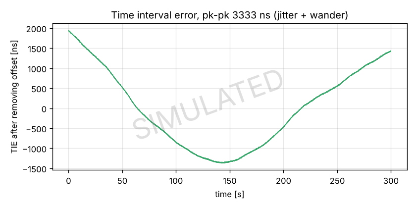
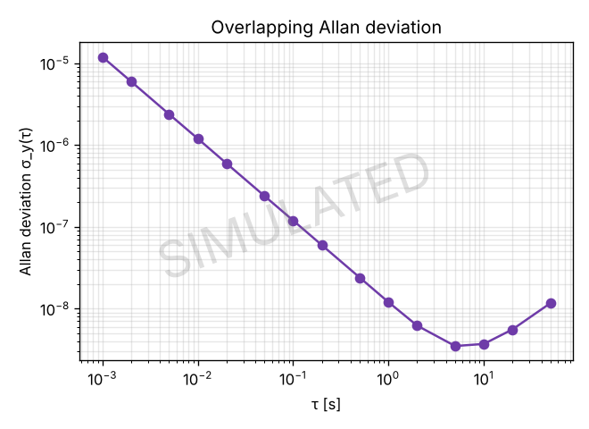
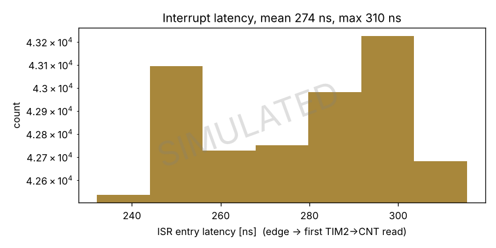

> **Simulated data, not a measurement.** See [the example README](../README.md).

## E3 board B vs reference (simulated)

Source log: `simulated (e3_board_b, generated by host/examples/make_demo.py)`  
Board: F446RE, UID `DE300002`, clock **HSE**, timer 84 MHz (1 tick = 11.905 ns)  
Reference: 1000 Hz nominal, 300000 edges over 300.0 s

| Quantity | Value |
|---|---|
| Period jitter, 1σ | 9.77 ns |
| Period jitter, peak-to-peak | 83.3 ns (7 ticks) |
| Cycle-to-cycle jitter, 1σ | 16.92 ns |
| Timer quantisation floor (tick/√6) | 4.86 ns |
| Frequency offset vs reference | -4.274 ppm (±4e-05, 95 %) |
| Accumulated drift at end of run | -1282.85 µs after 300.0 s |
| TIE (offset removed), peak-to-peak | 3333.1 ns |
| Allan deviation at τ = 1 s | 1.20e-08 |
| ISR latency mean / p99.9 / max | 274 / 310 / 310 ns |
| ISR latency in ticks (min..max) | 20 .. 26 |
| Missing cycles / glitch edges / over-captures | 0 / 0 / 0 |

