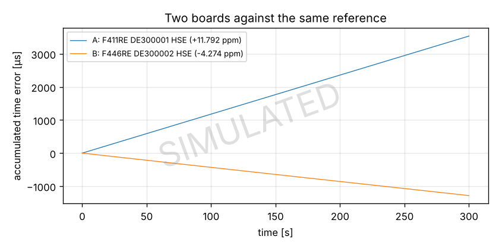

> **Simulated data, not a measurement.** See [the example README](../README.md).

## Board comparison

| | Board A | Board B |
|---|---|---|
| Log | `simulated (e3_board_a, generated by host/examples/make_demo.py)` | `simulated (e3_board_b, generated by host/examples/make_demo.py)` |
| Target / UID / clock | F411RE / `DE300001` / HSE | F446RE / `DE300002` / HSE |
| Duration | 300.0 s | 300.0 s |
| Offset vs reference | +11.792 ppm | -4.274 ppm |
| Period jitter 1σ | 9.77 ns | 9.77 ns |
| ISR latency mean / max | 321 / 357 ns | 274 / 310 ns |

**Offset A − B: +16.066 ppm (±4.1e-05, 95 %)** - the two clocks separate by 57.8 ms per hour.

_Different boards. If both captured the same reference simultaneously, the reference error cancels._

