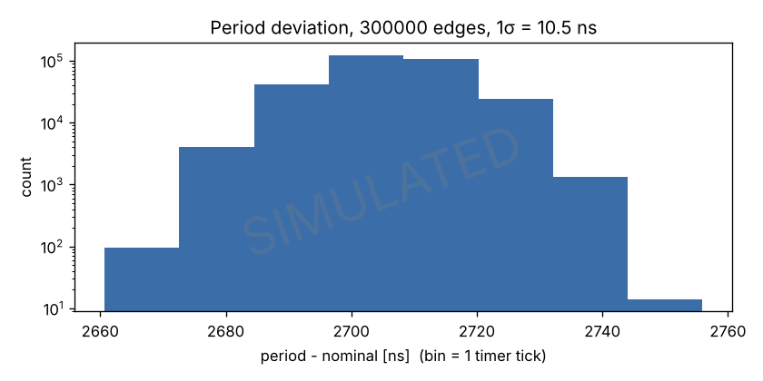
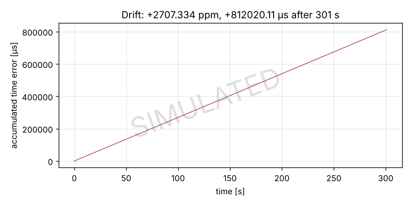
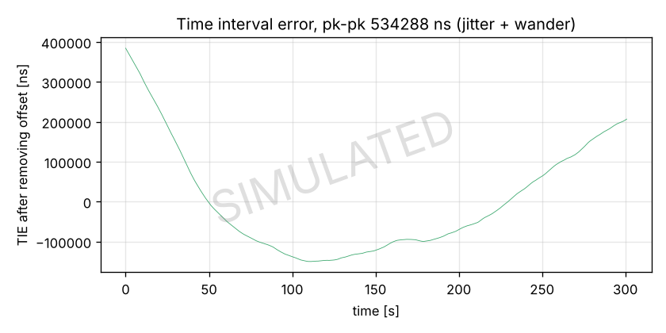
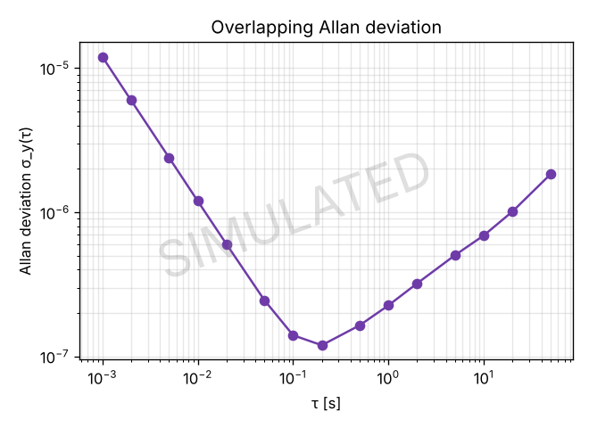
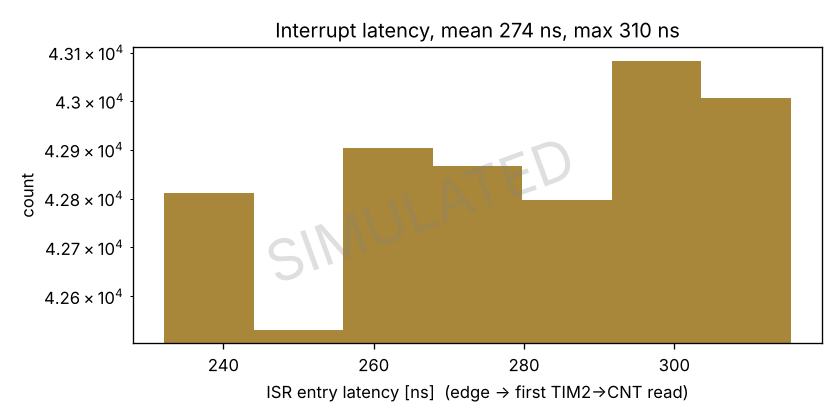

> **Simulated data, not a measurement.** See [the example README](../README.md).

## E5 board B on HSI vs reference (simulated)

Source log: `simulated (e5_board_b_hsi, generated by host/examples/make_demo.py)`  
Board: F446RE, UID `DE300002`, clock **HSI**, timer 84 MHz (1 tick = 11.905 ns)  
Reference: 1000 Hz nominal, 300000 edges over 300.8 s

| Quantity | Value |
|---|---|
| Period jitter, 1σ | 10.51 ns |
| Period jitter, peak-to-peak | 83.3 ns (7 ticks) |
| Cycle-to-cycle jitter, 1σ | 16.97 ns |
| Timer quantisation floor (tick/√6) | 4.86 ns |
| Frequency offset vs reference | +2707.334 ppm (±0.0056, 95 %) |
| Accumulated drift at end of run | +812020.11 µs after 300.8 s |
| TIE (offset removed), peak-to-peak | 534287.6 ns |
| Allan deviation at τ = 1 s | 2.26e-07 |
| ISR latency mean / p99.9 / max | 274 / 310 / 310 ns |
| ISR latency in ticks (min..max) | 20 .. 26 |
| Missing cycles / glitch edges / over-captures | 0 / 0 / 0 |

